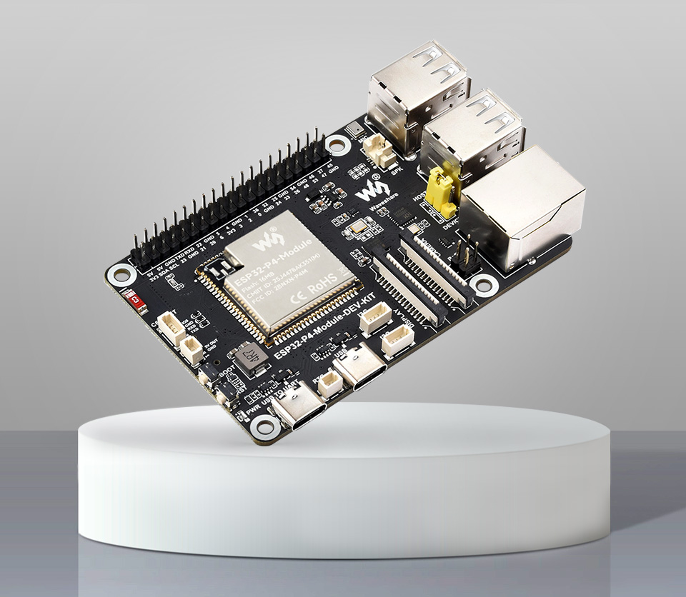
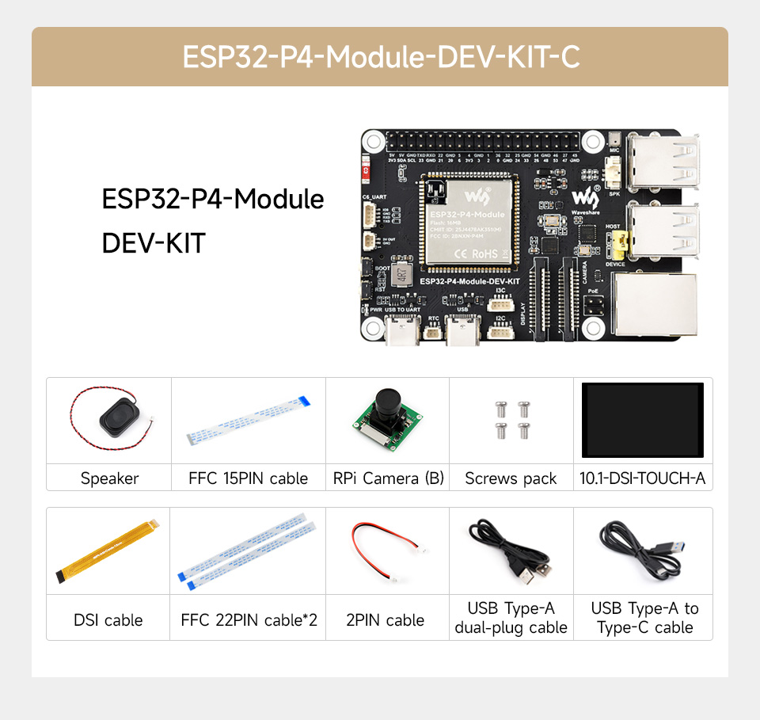
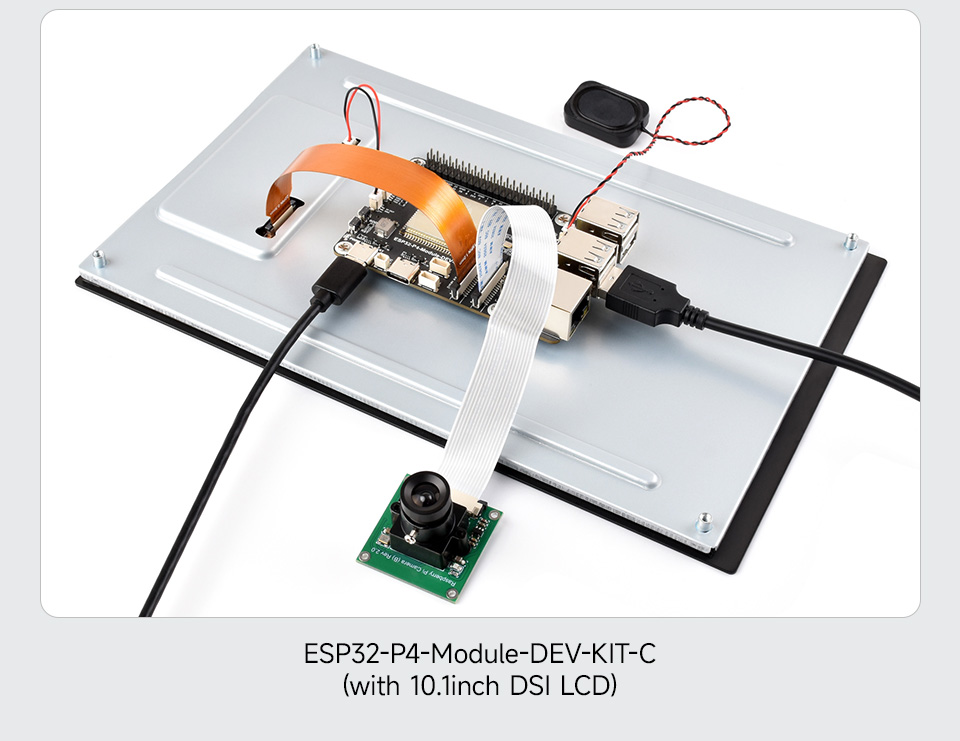
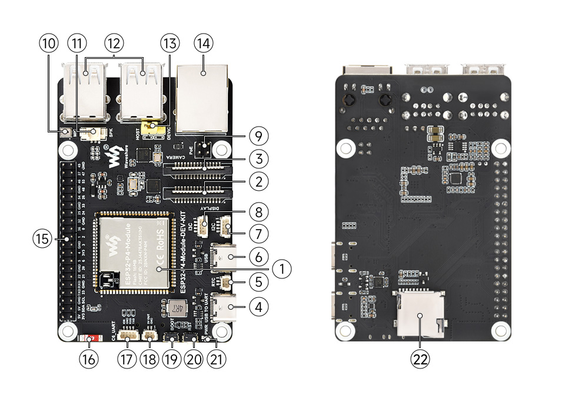
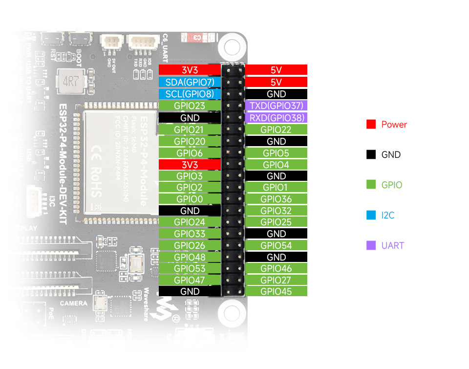

# ESP32-P4 USB Extended Display for Waveshare 10.1" DSI (JD9365 + GT911)

Biến bo mạch **Waveshare ESP32-P4-Module-DEV-KIT** kết hợp màn hình cảm ứng **Waveshare 10.1inch DSI LCD (JD9365, 800×1280)** thành màn hình phụ mở rộng (Secondary USB Display) cho máy tính Windows 10/11 qua cổng USB tốc độ cao.

Dự án này được port và tối ưu từ dự án gốc: [MakersFunDuck/usb_extend_screen_CrowPanel_Advanced_10.1inch](https://github.com/MakersFunDuck/usb_extend_screen_CrowPanel_Advanced_10.1inch) (vốn thiết kế riêng cho Elecrow CrowPanel 10.1").

---

> [!WARNING]
> ### ⚠️ CHÚ Ý ĐẶC BIỆT VỀ CÁP KẾT NỐI VÀ CỔNG USB (QUAN TRỌNG NHẤT)
> Bo mạch Waveshare ESP32-P4 Dev-Kit có cụm **4 cổng USB-A** và **2 cổng Type-C**:
> 1. **Cổng nạp code / Debug UART (Type-C):** Cổng Type-C trên mạch **CHỈ** dùng để nạp firmware qua cổng COM (UART/Serial) và cấp nguồn cơ bản. **Cổng này KHÔNG dùng để xuất màn hình!**
> 2. **Cổng xuất màn hình phụ & Cảm ứng (USB-A Host/Device):** Để truyền hình ảnh Desktop Windows và tín hiệu cảm ứng đa điểm sang ESP32-P4, **BẮT BUỘC sử dụng CÁP USB Type-A to Type-A (USB 2.0/3.0 A-to-A)** cắm từ cổng USB của máy tính PC vào **1 trong 4 cổng USB-A** trên bo mạch!
>    - *Rất nhiều người nhầm lẫn cắm cáp Type-C vào PC rồi thắc mắc tại sao Windows chỉ nhận cổng COM mà không xuất được hình ảnh hay cảm ứng.*

---

## 📸 Hình ảnh phần cứng (Hardware Overview)

<p align="center">
  
</p>

### Bộ kit hoàn chỉnh (ESP32-P4-Module-DEV-KIT-C kèm màn hình 10.1" DSI):
<p align="center">
  
</p>

### Kết nối thực tế bo mạch và màn hình 10.1" DSI LCD:
<p align="center">
  
</p>

### Chi tiết các cổng kết nối và linh kiện trên bo mạch:
*(Lưu ý vị trí cụm 4 cổng USB-A dùng cho cáp USB A-to-A để truyền màn hình và cổng Type-C UART)*
<p align="center">
  
</p>

### Sơ đồ chân Pinout chi tiết:
<p align="center">
  
</p>

---

## 🌟 Tính năng nổi bật

- **Xuất màn hình phụ Windows qua cáp USB Type-A to Type-A** (tốc độ cao High-Speed).
- **Hỗ trợ cảm ứng đa điểm (Touchscreen HID)**: Nhận diện trực tiếp như một màn hình cảm ứng Tablet PC trên Windows.
- **Tương thích chip ESP32-P4 mới nhất**: Hỗ trợ đầy đủ silicon revision v3.2 (ECO4).
- **Driver màn hình tối ưu**: Sử dụng `esp_lcd_jd9365_10_1` kết hợp bộ điều khiển cảm ứng I2C `esp_lcd_touch_gt911` (GPIO 7, GPIO 8).
- **Cung cấp sẵn file nhị phân (Prebuilt Binaries)**: Người dùng mới không cần cài đặt ESP-IDF phức tạp vẫn có thể nạp và sử dụng ngay lập tức.

---

## 🛠️ Yêu cầu phần cứng

1. **Bo mạch:** [Waveshare ESP32-P4-Module-DEV-KIT (SKU: 30844 / Kit C)](https://www.waveshare.com/esp32-p4-module-dev-kit.htm?sku=30844).
2. **Màn hình:** Waveshare 10.1inch DSI LCD (IC driver JD9365, cảm ứng GT911/GT9271, độ phân giải 800×1280).
3. **Cáp kết nối cần chuẩn bị:**
   - **01 Cáp Type-C:** Dùng để nạp firmware qua cổng UART COM.
   - **01 Cáp USB Type-A to Type-A:** Cắm từ PC sang **cổng USB-A (1 trong 4 cổng)** trên kit để truyền dữ liệu màn hình & cảm ứng.

### Sơ đồ chân ngoại vi trên ESP32-P4 Waveshare:
| Chức năng | Chân GPIO | Ghi chú |
| :--- | :--- | :--- |
| **I2C SDA** | `GPIO 7` | Cảm ứng GT911 |
| **I2C SCL** | `GPIO 8` | Cảm ứng GT911 |
| **Touch INT** | `GPIO 20` | Ngắt cảm ứng |
| **Touch RST** | `GPIO 21` | Reset cảm ứng |
| **Backlight PWM** | `GPIO 26` | Đèn nền màn hình (LEDC) |
| **LCD Reset** | `GPIO 27` | Reset panel JD9365 |
| **MIPI DSI** | 2-Lane | Cấp nguồn LDO3: 2500mV |

---

## ⚡ Cách 1: Nạp nhanh không cần cài ESP-IDF (Khuyên dùng)

Dành cho người dùng muốn sử dụng ngay:

1. Tải toàn bộ repository này về máy tính.
2. Cắm cáp Type-C vào cổng **UART** của kit ESP32-P4 để nạp.
3. Chạy file **`flash_firmware.bat`** (yêu cầu máy đã cài Python và esptool):
   ```cmd
   flash_firmware.bat
   ```
   Nhập cổng COM hiển thị trong Device Manager (ví dụ `COM27`) và chờ hoàn tất.

*Hoặc sử dụng công cụ đồ họa **Espressif Flash Download Tool**:*
- Chọn chip **ESP32-P4**, chế độ **Develop**.
- Nạp 3 file trong thư mục `binaries/`:
  - `bootloader.bin` -> Địa chỉ `0x2000`
  - `partition-table.bin` -> Địa chỉ `0x8000`
  - `usb_touch_screen.bin` -> Địa chỉ `0x10000`
- Chọn SPI SPEED: `80MHz`, SPI MODE: `DIO`, chọn cổng COM và bấm **START**.

---

## 💻 Cách 2: Tự biên dịch bằng ESP-IDF

Yêu cầu: **ESP-IDF v5.4.3** hoặc **v5.5.x**.

1. Mở terminal ESP-IDF và clone dự án:
   ```bash
   git clone https://github.com/YourUsername/ESP32P4_USB_Extended_Display_Waveshare.git
   cd ESP32P4_USB_Extended_Display_Waveshare
   ```

2. Cài đặt target ESP32-P4:
   ```bash
   idf.py set-target esp32p4
   ```

3. Biên dịch và nạp vào mạch:
   ```bash
   idf.py build
   idf.py -p COMxx flash monitor
   ```

---

## 🖥️ Cài đặt Driver hiển thị trên Windows

Để Windows nhận diện và truyền hình ảnh qua cổng USB sang ESP32-P4, bạn cần cài đặt **Windows Indirect Display Driver (IDD)**:

1. Tải bộ cài driver đã ký điện tử:
   👉 [Tải bộ cài IDD Driver (.exe)](https://dl.espressif.com/AE/esp-iot-solution/xfz1986_usb_graphic_250224_rc_sign.exe)
2. Chạy file `.exe` và hoàn tất cài đặt.
3. Cắm cáp **USB Type-A to Type-A** từ máy tính vào **1 trong 4 cổng USB-A** của kit Waveshare.
4. Màn hình sẽ sáng lên hiển thị dải màu khởi động (Color bars) và Windows sẽ tự động mở rộng màn hình desktop (Extended Desktop).

---

## 🎯 Cấu hình Cảm ứng chính xác (Khắc phục lỗi chạm nhảy sang màn hình khác)

Khi kết nối với máy tính có nhiều màn hình, Windows có thể gán nhầm cảm ứng sang màn hình chính hoặc màn hình 27 inch. Thực hiện theo hướng dẫn sau để định vị chính xác:

1. Bấm tổ hợp phím **`Windows + R`**, nhập:
   ```text
   control.exe /name Microsoft.TabletPCSettings
   ```
   rồi nhấn **Enter**.
2. Tại mục **Display**, bấm nút **Reset...** (nếu có sáng) để xóa bỏ cấu hình cũ.
3. Bấm nút **Setup...** (Cấu hình...) -> chọn **Touch screen**.
4. **LƯU Ý QUAN TRỌNG:**
   - Màn hình chuyển sang màu trắng kèm dòng chữ *"Tap this screen with a single finger..."*.
   - **CHƯA ĐƯỢC CHẠM VÀO MÀN HÌNH.**
   - Nhấn phím **`ENTER`** trên bàn phím để chuyển dòng chữ đó qua từng màn hình, cho đến khi dòng chữ hiển thị trên **Màn hình Waveshare 10.1 inch**.
   - Khi dòng chữ đã nằm trên màn hình 10.1 inch, hãy **chạm 1 ngón tay vào màn hình 10.1 inch**.
   - Bấm **`ENTER`** để lưu và hoàn tất.

---

## 🔄 Các thay đổi so với dự án gốc Elecrow CrowPanel

Dự án này đã được tinh chỉnh để chạy tương thích tuyệt đối trên hệ sinh thái Waveshare:
- Đã thêm `waveshare/esp_lcd_jd9365_10_1` vào `main/idf_component.yml`.
- Cấu hình lại chân I2C Touch (`SDA: 7, SCL: 8, INT: 20, RST: 21`) và Backlight PWM (`GPIO 26`) trong `board_peripherals.yaml` & `board_devices.yaml`.
- Bổ sung cấu hình bật nguồn DSI LDO3 (2500mV) và xung reset (`GPIO 27`) trong `setup_device.c`.
- Kích hoạt silicon revision v3.2 (`CONFIG_ESP32P4_REV_MIN_301=y`) trong `sdkconfig.defaults.esp32p4`.

---

## 📄 License & Lời cảm ơn

- Dự án kế thừa giấy phép từ [usb_extend_screen_CrowPanel_Advanced_10.1inch](https://github.com/MakersFunDuck/usb_extend_screen_CrowPanel_Advanced_10.1inch).
- Cảm ơn **Espressif** với giải pháp `esp-iot-solution` và **MakersFunDuck** đã phát triển bản gốc.
